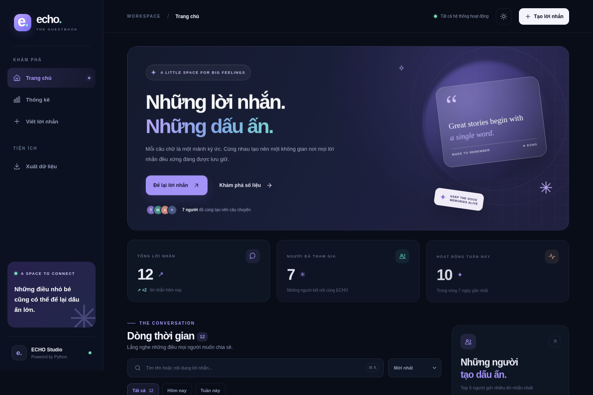

# ✳ ECHO — Leave a Trace

**Mỗi lời nhắn, một dấu ấn.** Sổ lưu bút số với giao diện tiếng Việt, FastAPI, SQLite, JSON và biểu đồ Matplotlib.

> **Bản Vibe Code** của bài tập nhóm *Lập trình web với Python* (`BTWeb.docx`). Giao diện premium, backend Python thực, dữ liệu lưu bền vững, biểu đồ Matplotlib sinh thật — không mockup.

## 🖼️ Giao diện



Hình chụp thực tế giao diện khi chạy: [Dashboard thống kê](previews/stats.png) · [Bản mobile](previews/mobile-add.png).

## ⚡ Chạy dự án

**Yêu cầu:** Python 3.10+ và pip. Không cần tài khoản hay dịch vụ cloud.

```bash
# 1. Mở terminal trong thư mục ECHO_Guestbook
python -m pip install -r requirements.txt

# 2. Khởi chạy
python app.py
```

Mở **http://127.0.0.1:8000**. Trên macOS/Linux, dùng `python3` nếu máy không có lệnh `python`.

**Khởi chạy một bước:** Windows nhấp đúp `run_windows.bat`; macOS/Linux chạy `bash run_macos_linux.sh`. Cả hai sẽ cài thư viện rồi khởi động server.

> Windows: nhấn `Win + R`, gõ `cmd`; dùng `cd` để di chuyển vào thư mục, rồi chạy 2 lệnh trên. Cần cài Python và bật tùy chọn *Add Python to PATH*.

## 🚀 Chức năng

| Yêu cầu tài liệu | Cách ECHO triển khai |
|---|---|
| `GET /` | Render `index.html` và danh sách `entries` từ **list Python** |
| `GET /add` | Form nhập `name`, `message` |
| `POST /add` | Kiểm tra không được trống; giới hạn 40/600 ký tự; lỗi hiển thị trong form; hợp lệ redirect `303` về `/` |
| `POST /delete/{id}` | Xóa theo ID, redirect về `/` (không cho xóa bằng GET để tránh nhầm) |
| Có DB | SQLite `guestbook.db`, tự tạo bảng và đồng bộ |
| JSON bền vững | Đọc `data.json` khi khởi động; ghi file atomically sau mỗi lần thêm/xóa |
| `GET /stats` | Tổng lời nhắn, Top 5 người gửi theo tên, thêm thống kê mở rộng |
| Matplotlib | Biểu đồ cột `static/generated/stats.png` và biểu đồ hoạt động `activity.png` được nhúng vào HTML |

**Tiện ích nâng cao:** tìm kiếm tức thì theo tên/nội dung; lọc hôm nay/7 ngày; sắp xếp; dark/light mode; xem trước lời nhắn; gợi ý viết nhanh; chia sẻ link; hộp thoại xác nhận xóa; responsive trên điện thoại; tải JSON export; REST API.

## 🗂️ Cấu trúc

```text
ECHO_Guestbook/
├── app.py                # FastAPI routes /, /add, /delete/{id}, /stats, APIs
├── storage.py            # Python list + SQLite + JSON atomic persistence
├── charts.py             # Matplotlib -> PNG
├── data.json             # 12 lời nhắn DỮ LIỆU MẪU (demo)
├── guestbook.db          # Tự tạo khi chạy, SQLite
├── requirements.txt      # Dependency list
├── README.md
├── tests/
│   └── test_app.py       # Kiểm thử tự động
├── templates/
│   ├── base.html         # Shell và navigation
│   ├── index.html        # Trang chủ/tất cả lời nhắn
│   ├── add.html          # Form và live preview
│   ├── stats.html        # Dashboard thống kê
│   └── 404.html
└── static/
    ├── logo.svg
    ├── css/style.css
    ├── js/app.js
    └── generated/
        ├── stats.png     # Tự sinh bằng Matplotlib
        └── activity.png  # Tự sinh bằng Matplotlib
```

## 🧹 Làm mới dữ liệu demo

Tệp `data.json` đi kèm là **12 lời nhắn mẫu hư cấu** để bạn mở ứng dụng là thấy giao diện có nội dung và biểu đồ.

Muốn bắt đầu sạch, **dừng server** và xóa `data.json` **cùng** `guestbook.db` (nếu có), rồi chạy lại `python app.py`. Chương trình sẽ tạo JSON và database mới rỗng.

## 🔗 Các đường dẫn

| Endpoint | Method | Công dụng |
|---|---|---|
| `/` | GET | Trang chủ, timeline |
| `/add` | GET/POST | Thêm lời nhắn |
| `/delete/{id}` | POST | Xóa theo ID |
| `/stats` | GET | Dashboard + Matplotlib |
| `/export` | GET | Tải JSON |
| `/api/entries` | GET | JSON danh sách |
| `/api/stats` | GET | JSON thống kê |
| `/api/docs` | GET | Tài liệu REST API (Swagger UI; cần Internet để tải UI CDN) |
| `/health` | GET | Kiểm tra sức khỏe server |

## 🧪 Chạy kiểm thử

```bash
python -m pip install -r requirements-dev.txt
python -m pytest -q
```

Bộ test thử trang rỗng; validate input; CSRF; thêm; xóa; REST API; SQLite/JSON; đồ thị; dữ liệu không mất khi restart; chống XSS qua auto-escape template.

Kiểm tra thêm giới hạn 40/600 ký tự, Unicode/emoji, khoảng trắng và CSRF giữa các session. GitHub Actions tự chạy test trên Windows/Linux với Python 3.10 và 3.13. `pytest.ini` đặt dữ liệu test trong `.pytest-tmp/` để tránh lỗi quyền thư mục tạm trên Windows.

Các file runtime (`guestbook.db`, `.session_key`, biểu đồ sinh tự động và thư mục test) được bỏ qua bởi Git. `data.json` chứa dữ liệu demo; không commit lời nhắn riêng tư sau khi sử dụng.

## 🔐 Ghi chú kỹ thuật

- Server tự tạo `.session_key` bí mật để duy trì session và bảo vệ POST bằng **CSRF token**.
- Chạy trên `127.0.0.1:8000` cho mục đích demo local. Nếu triển khai public, cần reverse proxy HTTPS, kiểm soát phân quyền/quyền xóa, rate limit và backup — bản bài tập chưa bổ sung tài khoản đăng nhập.
- **JSON là nguồn dữ liệu chính khi ứng dụng khởi động**, SQLite đồng bộ. Nếu cần nhập dữ liệu cũ, hỗ trợ file JSON ở dạng list hoặc `{"entries": [...]}`.
- SQLite, JSON và biểu đồ được cập nhật khi thêm/xóa; icon SVG và giao diện chính là asset local. Font từ Google Fonts là tùy chọn, có font hệ thống dự phòng khi offline.
- `GUESTBOOK_DATA_DIR` cho phép đổi nơi đặt file data/SQLite (hữu ích khi test hoặc deploy); `PORT` thay cổng, `GUESTBOOK_SECRET_KEY` thay session key.

## 🎓 Thuyết trình bài tập

1. Giới thiệu giao diện và `GET /` hiển thị Python `entries`.
2. Nhập thử form `/add`: để trống thấy lỗi, nhập đúng thì thêm và redirect về trang chủ.
3. Xóa theo ID và giải thích vì sao POST an toàn hơn GET.
4. Mở `data.json` và SQLite để chứng minh dữ liệu đã được lưu; restart server để chứng minh không mất dữ liệu.
5. Mở `/stats`, giải thích `Counter` và biểu đồ Matplotlib lưu file PNG rồi nhúng HTML.
6. Giới thiệu các tính năng Vibe Code bổ sung: tìm kiếm/lọc, live preview, theme, export và API.

**Lưu ý:** Tài liệu gốc yêu cầu nhóm xây dựng **cả hai phiên bản Vibe Code và Manual**. Dự án này là bản Vibe Code; bản Manual cần làm riêng nếu giáo viên yêu cầu nộp cả hai.
